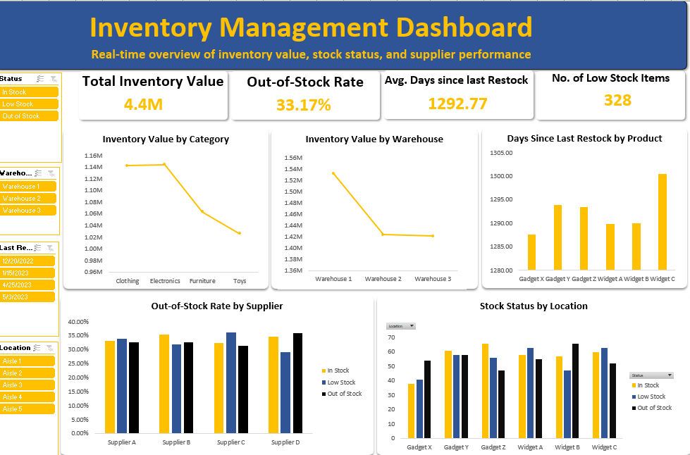

# Supply Chain Inventory Analysis

An Excel-based supply chain inventory analysis project focused on data cleaning, inventory management, stock status, supplier performance, and restocking insights.

## Project Overview

This project analyses a supply chain inventory dataset containing 1,000 records to evaluate inventory distribution, stock availability, supplier performance, and restocking patterns.
The analysis was carried out using Microsoft Excel, with a focus on identifying inventory management issues and providing actionable business recommendations.

## Dataset Description

The dataset contains 1,000 inventory records with the following columns:

- Product ID
- Product Name
- Category
- Warehouse
- Location
- Quantity
- Price
- Supplier
- Status
- Last Restocked

## Tools Used

- Microsoft Excel
- Excel Formulas
- Pivot Tables
- Pivot Charts
- Slicers

## Data Cleaning and Preparation

The raw dataset was cleaned and prepared for analysis through the following steps:

- Removed extra spaces and standardised product names and categories.
- Converted text values in the Quantity column into numeric values.
- Standardised inconsistent date formats in the Last Restocked column.
- Addressed missing Price and Quantity values using values sampled from existing records within the same category.
- Resolved missing stock status values.
- Created calculated columns for Inventory Value and Days Since Restock.

## Analysis and Pivot Tables

Five pivot table analyses were created to answer key inventory management questions:

1. Inventory Value by Category and Warehouse: Examined how inventory value is distributed across product categories and warehouses.
2. Stock Status by Location: Analysed stock availability across different warehouse locations.
3. Out-of-Stock Rate by Supplier: Compared supplier performance based on stock availability.
4. Days Since Last Restock by Product: Identified products with the longest periods since their last restocking.
5. Products by Stock Status and Location: Identified specific products with low or unavailable stock across locations.

## Interactive Dashboard

An Excel dashboard was created to present the analysis visually. Two interactive slicers, Warehouse and Status, were added to allow users to filter the dashboard and explore inventory performance.

## Key Insights

- Clothing and Electronics recorded higher inventory values than Furniture and Toys.
- Warehouse 1 held more inventory value than Warehouse 2 and Warehouse 3 individually.
- Widget B experienced stock shortages in four out of five aisles, while Gadget X experienced shortages in two aisles.
- Supplier D recorded the highest out-of-stock rate at 36.02%, while Supplier B showed the highest in-stock rate at 35.42%.
- Supplier C had the largest share of low-stock items at 36.21%.
- All products had exceeded 1,280 days since their last restock, with Widget C recording the longest average period at          1,296.50 days.

## Recommendations

- Review inventory investment in Clothing and Electronics to ensure it aligns with actual demand.
- Evaluate inventory distribution across warehouses to reduce concentration risk.
- Prioritise restocking Widget B and Gadget X, particularly in locations with severe shortages.
- Review Supplier D's performance and consider alternative sourcing options.
- Monitor Supplier C's low-stock levels to prevent future stockouts.
- Prioritise restocking Widget C and establish a maximum restocking interval.
- Introduce an inventory tracking system to identify overdue products.

## Conclusion

This project demonstrates how Microsoft Excel can be used to clean, analyse, and visualise inventory data. The findings provide insights into stock availability, inventory distribution, supplier performance, and restocking patterns to support better inventory management and business decision-making.

## Project Files

- [Excel Workbook](https://github.com/Christy-portfolio/supply-chain-inventory-analysis/blob/main/Supply_Chain_Inventory_Analysis.xlsx)

- [Dashboard Image](https://github.com/Christy-portfolio/supply-chain-inventory-analysis/blob/main/Dashboard.png)
